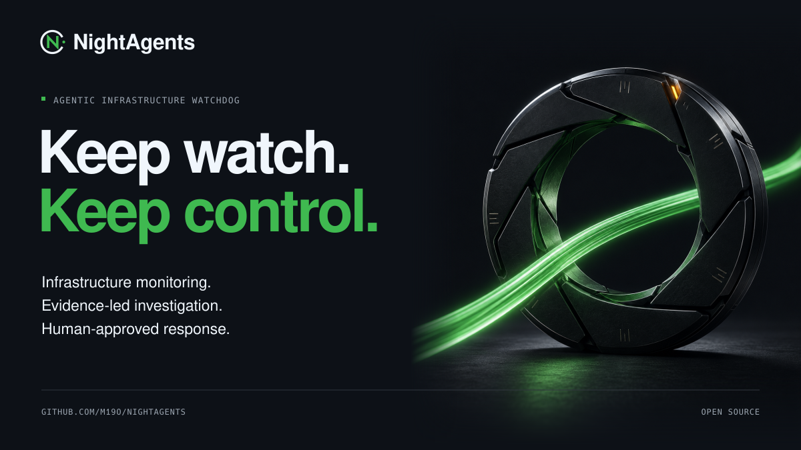

# NightAgents



**Agentic infrastructure watchdog for red team operations.**

NightAgents monitors your own redirector infrastructure for exposure and attack - the traffic rhythm your logs reveal, plus VirusTotal, Shodan, CT logs and abuse reports - investigates with AI agents under strict evidence rules, and responds with human-approved, callback-safe redirector rotation executed by a deterministic Safety Kernel.

The one rule that shapes everything: **models propose and reason; deterministic code owns authorization, signatures, approvals, grants, idempotency, state transitions, and callback-safety checks.** No model output can move traffic. Unknown callback continuity is never reported as success - it triggers rollback or operator intervention.

[](https://github.com/m19o/nightagents/actions/workflows/ci.yml)
[](LICENSE)

## What it does

- **Hunts agentically** - the NightWatcher agent queries Elastic through MCP, choosing its own hunts from a catalog allowlist, guided by a versioned hunting playbook (29 distilled field patterns). Findings without evidence are discarded in code. A deterministic beacon fingerprint remains as a safety net.
- **Investigates** - durable skill graphs with independently configured verifier, reasoner, predictor, and critic model identities. Source health is verified before evidence is trusted; absence of evidence is never a negative outcome.
- **Asks a human** - signed handoffs land in Slack with full detail (prediction, confidence, recommended action, evidence). Approve/Reject works over Socket Mode (no public URL) or signed HTTP webhooks.
- **Acts safely** - the Safety Kernel verifies the signed approval, mints an execution grant scoped to one plan and one tool, and moves traffic through the infrastructure MCP. Continuity is proven from independent telemetry, or it rolls back.
- **Learns** - predictions carry horizons; at expiry the confirmation query runs, outcomes feed calibration buckets, and misses create durable operator-review tasks.
- **Watches the world** - a third-party monitor tracks VirusTotal, Shodan, CT logs, and abuse feeds for your redirectors.

Everything is durable: agent runs pause/resume/cancel, every step and tool call is persisted, and a hash-linked audit chain covers every decision (`GET /api/v2/audit/verify`).

## Quickstart

```bash
git clone https://github.com/m19o/nightagents.git
cd nightagents
cp .env.example .env
docker compose --env-file .env up -d
bash demo/scripts/lab_provision.sh       # self-contained lab: payload + fleet + implant
python3 demo/scripts/live_show.py        # hunter -> AI -> your Slack click -> traffic moves
```

The live dashboard is at `http://127.0.0.1:8000/dashboard`. Full walkthrough: [docs/QUICKSTART.md](docs/QUICKSTART.md).

## Infrastructure control

`InfrastructurePort` backends: `database` (dry run), `lab` (demo traffic), `cloudflare` (real edge control - health from Cloudflare Analytics, switches as reversible DNS repoints, with an offline teaching sandbox), and external plugins. The Cloudflare path requires your own scoped token and is contract-tested; it is not credential-verified by the project.

## Documentation

- [docs/ARCHITECTURE.md](docs/ARCHITECTURE.md) - components, agent loop, MCP identity model
- [docs/SECURITY-MODEL.md](docs/SECURITY-MODEL.md) - what models may and may never do
- [docs/QUICKSTART.md](docs/QUICKSTART.md) - lab and platform deployment
- [demo/LABS.md](demo/LABS.md) - the six teaching scenarios
- [demo/GUIDE.md](demo/GUIDE.md) - lab internals, Slack setup, Mythic setup
- [demo/ludus/](demo/ludus/) - deploy the lab on a Ludus cyber range
- [SECURITY.md](SECURITY.md) - vulnerability reporting

## Development

```bash
pip install -e ".[dev]"
ruff check src tests
python -m pytest tests -q
bash scripts/ci-evaluation-gate.sh   # replay evaluation regression gate
```

## Acknowledgments

NightAgents stands on the shoulders of the tools it watches and talks to, and the people who built them:

- [Mythic](https://github.com/MythicMeta/Mythic) by [SpecterOps](https://specterops.io) and Cody Thomas ([@its_a_feature_](https://twitter.com/its_a_feature_)) - the C2 framework whose callbacks the lab protects
- [Elastic Stack](https://www.elastic.co/elastic-stack) - the SIEM that holds redirector telemetry
- [Model Context Protocol](https://modelcontextprotocol.io) by Anthropic - the boundary between models and tools; every capability the agents touch is an MCP tool
- [Slack](https://api.slack.com) - the human approval channel
- [Cloudflare](https://developers.cloudflare.com/api/) - CDN-backed redirector fronting in production mode
- [nginx](https://nginx.org) - the redirector workhorse whose logs feed detection
- [Ludus](https://ludus.cloud) by [Bad Sector Labs](https://badsectorlabs.com) - the cyber range platform that hosts the teaching labs, via their [role template](https://github.com/badsectorlabs/ludus_ansible_role_template) and Erik's [SSRF-to-Hash role](https://gitlab.com/badsectorlabs-erik/ludus-ssrf-to-hash) as the worked example
- [Ollama](https://ollama.com) - local models for low-resource lab runs

And the people whose public work shaped how this project thinks about redirectors and blue-team detection:

- Jeff Dimmock ([@bluscreenofjeff](https://x.com/bluscreenofjeff)) - the classic [Red Team Infrastructure Wiki](https://github.com/bluscreenofjeff/Red-Team-Infrastructure-Wiki) and redirector design writing that taught a generation how this infrastructure is built
- The SpecterOps blog and research team - years of public adversary-simulation tradecraft

Built with [FastAPI](https://fastapi.tiangolo.com), [SQLAlchemy](https://www.sqlalchemy.org)/[Alembic](https://alembic.sqlalchemy.org), [Pydantic](https://docs.pydantic.dev), and [httpx](https://www.python-httpx.org).

## In the field

NightAgents was delivered as a hands-on tactic at the DEF CON Red Team Village, where the workshop placed third in attendee interest and participation.

## Scope

NightAgents is defensive tooling for authorized infrastructure only. It does not implement guardrail bypasses, stealth/evasion automation, uncontrolled C2 deployment, or victim execution. The lab runs entirely in local containers.

Licensed under [Apache-2.0](LICENSE). See [NOTICE](NOTICE).
