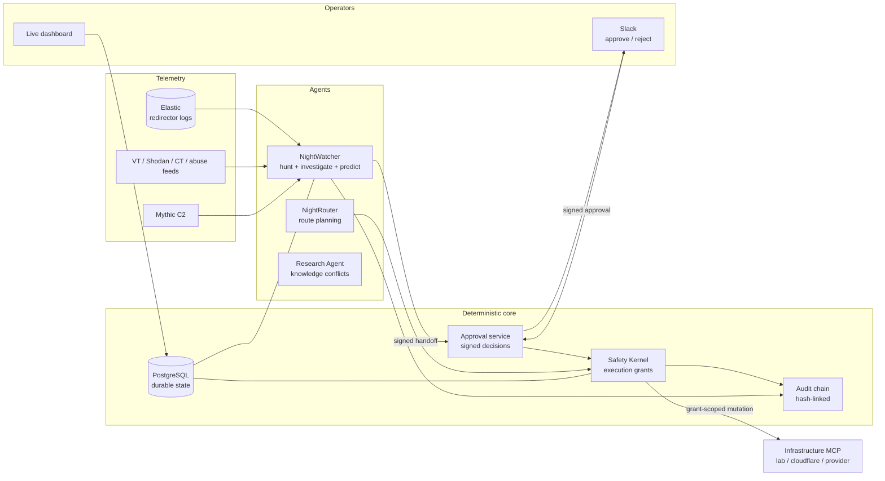

# NightAgents Architecture

NightAgents is an **agentic infrastructure watchdog** for red team operations. AI agents monitor your own redirector infrastructure - the traffic rhythm your logs reveal, plus VirusTotal, Shodan, CT logs and abuse reports - investigate with strict evidence rules, and respond with human-approved, callback-safe redirector rotation executed by a deterministic Safety Kernel.

The one rule that shapes everything: **models propose and reason; deterministic code owns authorization, signatures, approvals, grants, idempotency, state transitions, and callback-safety checks.** No model output can move traffic.

## Component map

## The agent loop

1. **Hunt** (`AgenticNightWatcher.hunt`): on the scheduler cadence the NightWatcher agent queries Elastic through the MCP gateway, choosing its own hunts from a catalog allowlist, guided by a versioned hunting playbook (`skills/nightwatcher/hunt-redirector-telemetry/playbook.md`). Findings without elastic evidence ids are discarded in code; incidents open with deterministic content-hash ids (idempotent). A deterministic beacon fingerprint (`DetectionService`) remains as a documented safety net.
2. **Investigate**: a durable skill graph - source health, elastic evidence, memory recall, Mythic callback inventory - then model phases (evidence verifier, reasoner, predictor, critic) as independently configured model identities. Any abstention stops the line.
3. **Handoff**: the watcher emits a signed handoff (HMAC, payload hash) with a prediction and a recommended action. Posted to Slack with full details.
4. **Approval**: a human clicks Approve/Reject in Slack (Socket Mode websocket or signed HTTP webhook - one shared handler, one audit trail). The approval is itself signed; a handoff decided once cannot be re-decided.
5. **Execute**: the Safety Kernel verifies the approval signature, mints an execution grant scoped to exactly one plan and one tool, and NightRouter executes through the infrastructure MCP. Continuity is verified from independent telemetry (edge logs or provider analytics). **Unknown continuity is never success** - it triggers rollback or operator review.
6. **Learn**: predictions carry horizons; at expiry the declared confirmation query runs, outcomes feed calibration buckets, and misses create durable operator-review tasks.

## MCP identity model

All external capabilities are accessed through MCP servers; provider SDKs live inside those servers, never in the agents. Three principals with separate tokens:

- `nightwatcher` - read-only: elastic, mythic inventory, memory, infrastructure health, third-party feeds.
- `safety-kernel` - mutation-capable: infrastructure plan/execute/rollback, only with a valid execution grant.
- `research-agent` - memory + third-party only; can propose knowledge candidates, can never activate them (human approval required).

Planning and mutation never share an identity.

## Infrastructure providers

`InfrastructurePort` (`src/nightagents/ports/infrastructure.py`) is the contract: `route_health`, `plan_route_switch`, `execute_route_switch`, `rollback_route_switch`, `verify_callback_route`. Backends:

- `lab` - moves real demo traffic (victim resolver repoint + Elastic continuity proof). Used by the teaching lab.
- `database` - records intent without touching anything (default).
- `cloudflare` - real edge control: health from Cloudflare Analytics + zone status, switches as reversible DNS repoints, rollback restores the previous record. Ships with an offline teaching sandbox speaking CF's real API contract. The real API path requires the operator's own scoped token (DNS:Edit, Analytics:Read) and is contract-tested, not yet credential-verified by the project.
- `provider` - external plugins via the `nightagents.infrastructure` entry-point group.

## Durability

Agent runs are durable graphs in PostgreSQL: every step, tool call, model identity and version is persisted; runs can pause, resume, cancel, and be replayed by the evaluation harness (`evaluations/fixtures/`). Every meaningful event is appended to a hash-linked audit chain (`GET /api/v2/audit/verify`).
